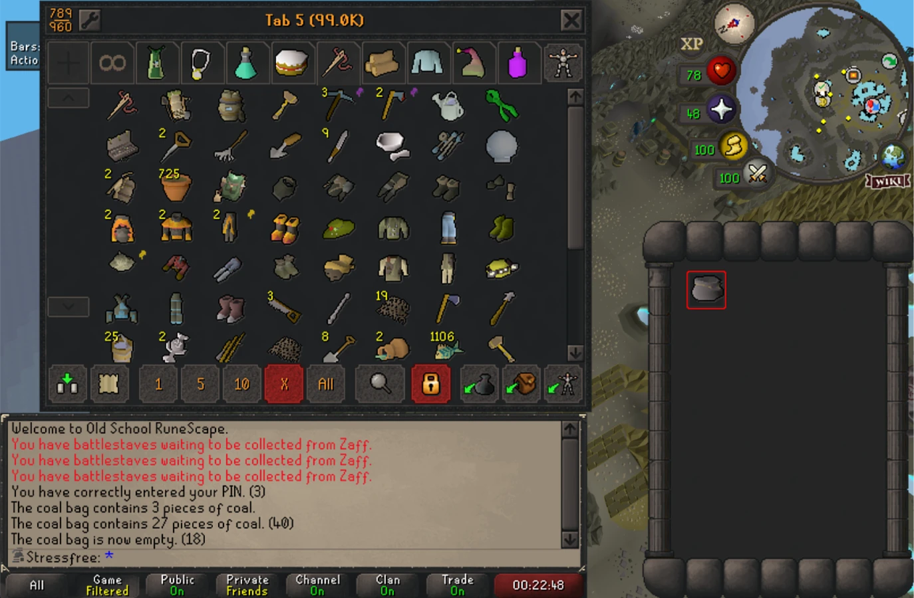
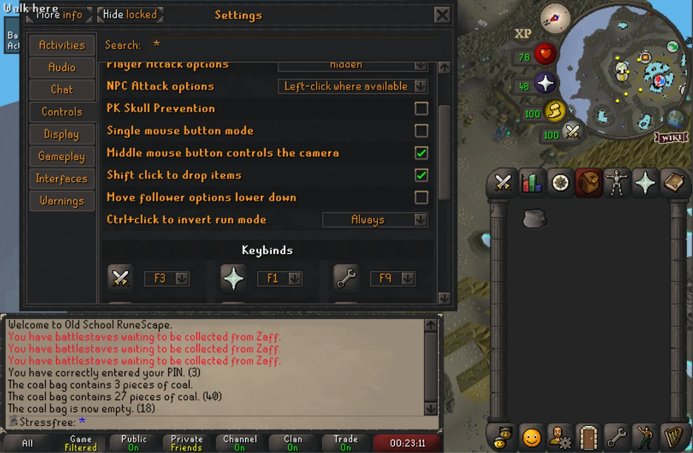

# Gruvbox

A dark, warm resource pack for the RuneLite [Resource Packs](https://github.com/melkypie/resource-packs) plugin, based on the [Gruvbox](https://github.com/morhetz/gruvbox) dark colour scheme, with the dialog parchment in Gruvbox light creams and the chatbox in a Gruvbox grey tan.

No sprite is redrawn. Every texture keeps the vanilla shapes, shading and transparency, and only the colours change, so the pack stays easy to keep in step with game updates. Icons, items, spells, skills and other coloured art are left vanilla.

## Screenshots

## What changes

| Area | Colours |
| --- | --- |
| Stone shell, tabs, buttons, bank, GE | Gruvbox dark greys, from `#141617` outlines through `#282828` and `#32302f` to `#a89984` highlights |
| Borders and separators | `#141617` (outer) to `#7c6f64` |
| Dialog parchment | Gruvbox light creams `#d5c4a1` to `#fbf1c7`; vanilla dark text stays readable |
| Chatbox fill and compass | Gruvbox greys `#a89984` to `#bdae93`, keeping the vanilla shading |
| Chat frame | Gruvbox dark |
| Selected and accent highlights | Gruvbox orange `#fe8019` |
| Overlay | Translucent `#1d2021` |

## Building it yourself

`tools/` holds the PowerShell scripts that generate the pack from the vanilla sample pack:

- `recolor.ps1 -Scheme gruvbox|bordo|noctis|minimus` recolours the shell sprites onto that variant's ramp (`schemes.ps1`).
- `config.ps1 -Scheme ...` writes `vars.toml`, `overrides.toml` and `color.properties`.
- `icon.ps1` builds `icon.png`.

## Credits

- [Noctis](https://github.com/liviuschera/noctis) by Liviu Schera for the Noctis colour schemes and the tooling this pack began from.
- [melkypie](https://github.com/melkypie/resource-packs) for the Resource Packs plugin and the vanilla sample pack.
- The [Nord](https://github.com/melkypie/resource-packs/tree/pack-nord) and [Browntown](https://github.com/melkypie/resource-packs/tree/pack-browntown) packs, which were the inspiration for recolouring the vanilla shell.
