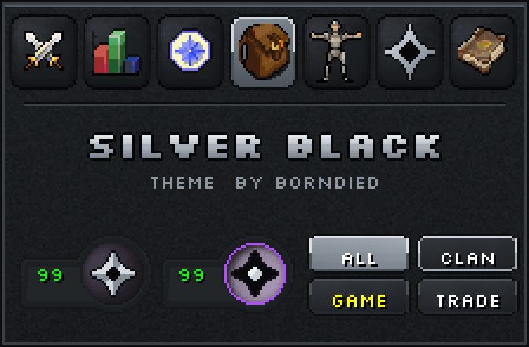
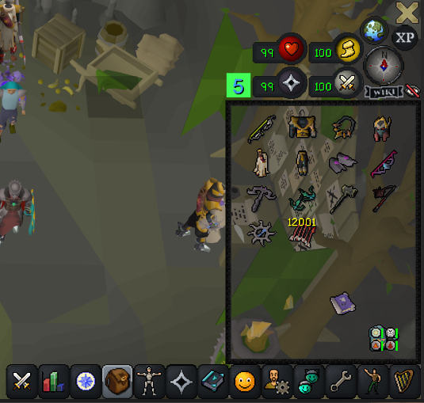
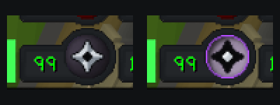
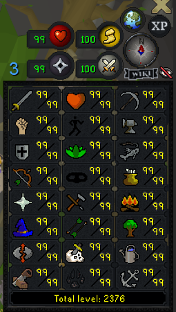
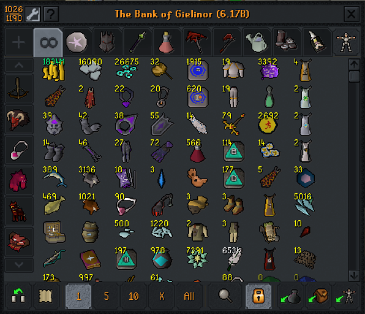
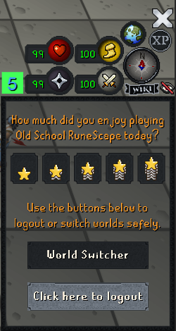
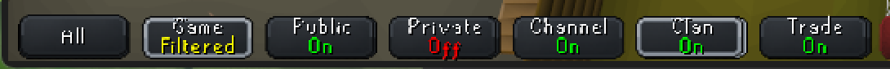

# Silver Black Theme by BornDied

A restrained soft-black and silver interface that keeps the familiar OSRS feel. Recoloured from the default game interface, with a custom prayer star and silver highlights for anything selected.

## Highlights
- Soft-black and charcoal panels with steel edges, built for resizable modern and bottom-bar layouts
- Custom four-point silver prayer star with a black core, on the orb and the prayer tab
- Prayer orb inverts when quick prayers are on: black star, plum fill, thin neon-purple rim
- Selected tabs, bank tabs, quantity buttons and chat buttons turn muted silver
- Graphite chat buttons, with a silver border on any tab that has new messages
- Near-black compass ring with a silver bevel and a silver-edged Wiki button
- Darker skill tiles so icons and levels stand out
- Item icons, skill icons and status colours left as they are

## Screenshots
Resizable:

Prayer orb, quick prayers off and on:

Skills:

Bank:

Logout:

New messages while the chat is minimised:

## How to install
Install **Resource Packs** from the RuneLite Plugin Hub, open its paintbrush panel and install **Silver Black Theme**.

## Credits
Made by BornDied. Banner lettering uses the Silkscreen font (SIL Open Font License).
